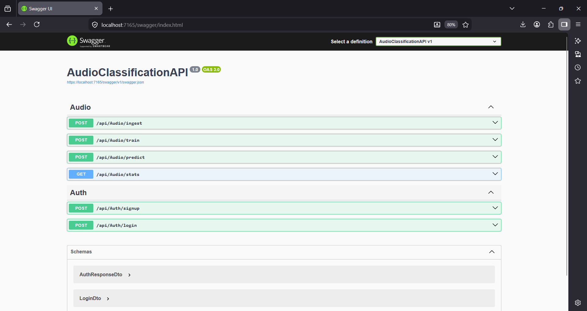

# Audio Sense Pro: Enterprise Acoustic Intelligence & Classification Platform

## 1. Executive Overview
Audio Sense Pro is a sophisticated acoustic classification system engineered to provide high-precision analysis of complex auditory signals. By integrating advanced digital signal processing (DSP) with modern machine learning paradigms, the platform offers an end-to-end solution for spectral categorization. The system is designed for scalability, featuring a robust ASP.NET Core 8.0 backend, an ML.NET-powered intelligence core, and a high-fidelity web-based operational dashboard.

---

## 2. Technical Architecture and Signal Processing

### 2.1 The Acoustic Processing Pipeline
The application utilizes a multi-layered approach to convert raw audio waves into actionable intelligence. This process is handled by the `AudioProcessingService` and the `FeatureExtractor`.

*   **Normalization and Interpretation**: Raw audio files (.wav, .mp3) are interpreted using the NAudio library, normalized to a standard floating-point array for consistent analysis across different recording qualities.
*   **Time-Domain Analysis**: 
    *   **Root Mean Square (RMS)**: Calculates the average power of the signal, providing essential volume and energy metrics.
    *   **Zero Crossing Rate (ZCR)**: Analyzes the rate at which the signal changes sign, serving as a primary indicator of spectral brightness and noisiness.
    *   **Temporal Variance**: Measures the amplitude fluctuations to distinguish between steady-state sounds and transient impulses.
*   **Frequency-Domain Analysis (MFCC)**: 
    *   Implements **Mel-Frequency Cepstral Coefficients** to mimic human auditory perception. 
    *   The system extracts 13 distinct coefficients that capture the "timbre" or unique quality of the sound, allowing the model to distinguish between similar frequencies (e.g., a car horn vs. a dog bark).

### 2.2 Machine Learning Intelligence Core
The predictive engine is built on the Microsoft ML.NET framework, utilizing a supervised multiclass classification model.

*   **Training Algorithm**: Employs the **L-BFGS (Limited-memory Broyden-Fletcher-Goldfarb-Shanno)** Maximum Entropy trainer. This algorithm is particularly effective for large feature sets and categorical classification.
*   **Evaluation Metrics**: Upon training completion, the system generates a `metadata.json` file containing:
    *   **Macro-Accuracy**: The average accuracy across all classes.
    *   **Micro-Accuracy**: The overall accuracy of all individual predictions.
    *   **Log-Loss**: Quantifies the uncertainty of the model's predictions.

---

## 3. Security and Authentication Framework

### 3.1 Stateless Identity Management
The platform implements a secure, stateless authentication layer using JSON Web Tokens (JWT).

*   **Identity Logic**: Users authenticate via a validated email address. The system enforces unique constraints on both email and username at the database level.
*   **Credential Protection**: All passwords undergo one-way cryptographic hashing using **BCrypt.Net**. This implementation includes automated salting and a configurable work factor to protect against brute-force and rainbow table attacks.
*   **Tokenization**: Upon successful authentication, a JWT is issued with a 24-hour expiration. This token encapsulates the user's claims and identity, which are then transmitted via the `Authorization: Bearer` header for all protected API requests.

---

## 4. Operational Interface (Frontend)

### 4.1 Design Paradigm
The user interface adheres to a modern "Glassmorphism" design system, characterized by:
*   **Backdrop Filter Overlays**: Creating a sense of depth and hierarchy.
*   **Dynamic Gradients**: Utilizing CSS3 linear gradients with keyframe animations to provide a living, interactive environment.
*   **Responsive Grid**: A fluid layout that ensures operational capability across desktops, tablets, and mobile devices.

### 4.2 Interactive Components
*   **Ingestion Engine**: A single-click interface that triggers the automated feature extraction process across the entire raw dataset.
*   **Real-time Analysis**: A drag-and-drop zone for audio files, providing immediate visual feedback including a classification label and a confidence percentage bar.
*   **Metrics Dashboard**: Real-time display of model health, including total sample count, precision ratings, and recall metrics.

---

## 5. System Interface Visuals

The following visuals demonstrate the operational flow and classification capabilities of the Audio Sense Pro platform.

### 5.1 Main Intelligence Dashboard
The centralized control panel accessed after secure authentication. It displays real-time model metrics (Samples, Precision, Recall) and provides integrated controls for data ingestion and model optimization.


### 5.2 Acoustic Classification: Dog Bark Detection
A demonstration of the engine's real-time prediction capabilities. In this instance, the system has successfully identified a 'DogBark' with a high confidence rating of 82.8% after analyzing the spectral features of the uploaded sample.


### 5.3 Acoustic Classification: Car Horn Detection
A secondary demonstration showcasing the engine's versatility. The system has accurately categorized a 'CarHorn' event with 91.3% confidence, illustrating the precision of the underlying ML.NET model and MFCC feature extraction.


### 5.4 API Documentation (Swagger UI)
Interactive API documentation showcasing all available endpoints including authentication, audio ingestion, training, and prediction workflows.


---

## 6. API Documentation Overview

### 5.1 Authentication Endpoints
*   `POST /api/auth/signup`: Registers a new user identity. Requires Username, Email, and Password.
*   `POST /api/auth/login`: Authenticates a user and returns a JWT. Requires Email and Password.

### 5.2 Acoustic Engine Endpoints
*   `POST /api/audio/ingest`: (Authorized) Scans raw data directories and generates a processed CSV dataset.
*   `POST /api/audio/train`: (Authorized) Initiates the ML.NET training pipeline and updates the operational model.
*   `POST /api/audio/predict`: (Authorized) Accepts a multipart file upload and returns the predicted class and confidence score.
*   `GET /api/audio/stats`: (Authorized) Retrieves current model performance metrics and training history.

---

## 6. Implementation and Setup

### 6.1 Database Configuration
The system uses Microsoft SQL Server. Ensure the connection string in `appsettings.json` is updated:
```json
"ConnectionStrings": {
  "DefaultConnection": "Server=(localdb)\\mssqllocaldb;Database=AudioClassificationDb;..."
}
```

### 6.2 Initializing the System
1.  **Clone the Repository**: Ensure all submodules and dependencies are pulled.
2.  **Apply Migrations**: Update the SQL schema to include the User and Audit tables.
    ```bash
    dotnet ef database update
    ```
3.  **Bootstrap Data**: Place raw audio samples in the `Data/Raw/` directory, organized by folder name (which serves as the label).
4.  **Run Application**:
    ```bash
    dotnet run
    ```

---

## 7. Project Structure

*   **Controllers/**: API logic and View rendering.
*   **Data/**: Persistent storage for raw audio, processed CSVs, and serialized ML models.
*   **Features/**: Mathematical implementations for MFCC and ZCR.
*   **Models/**: Data structures, DTOs, and Entity Framework configurations.
*   **Services/**: Core business logic and background processing.
*   **Views/**: Razor templates and frontend assets.

---

## 8. Developer
This project was developed by **Hariom Lokhande**.